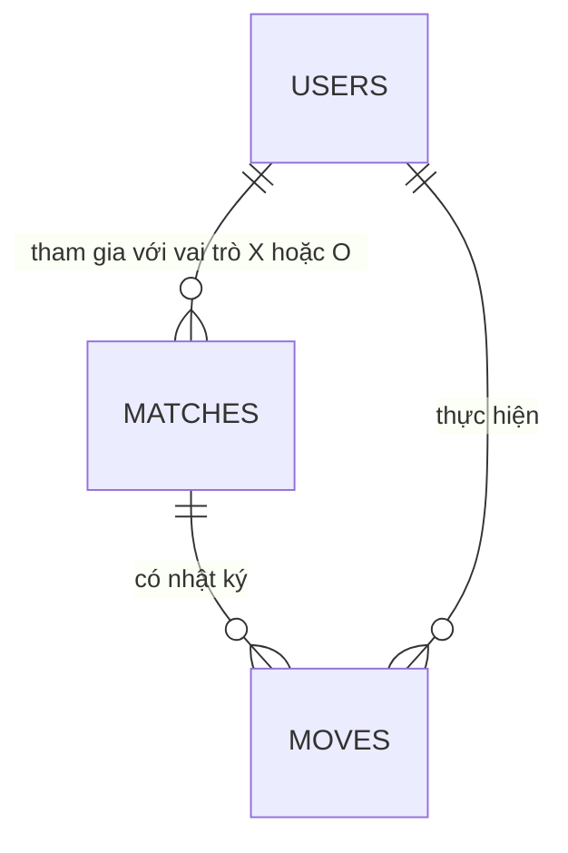

# Data Model — Cờ Caro trực tuyến

| Thực thể | Nơi lưu | Định danh và dữ liệu |
|---|---|---|
| User | SQLite | `user_id`; username duy nhất; password hash; điểm, thắng/hòa/thua |
| Session | RAM | Socket đang mở; user_id hoặc chưa xác thực; trạng thái; match_id hiện tại; bộ đệm nhận và hàng đợi gửi |
| Challenge | RAM | `challenge_id`; người mời, người được mời, hạn phản hồi, trạng thái |
| Match | RAM + SQLite | `match_id`; hai người chơi X/O, trạng thái, lý do và thời điểm. Bàn cờ, lượt, đồng hồ chờ ngắt kết nối và nhật ký tạm chỉ ở RAM |
| Move | RAM → SQLite khi chốt | Khóa `(match_id, seq)`; người đi, quân, hàng, cột |

- Lúc tạo ván: ghi hàng ACTIVE trong SQLite để có mã ván bền vững; chỉ thông báo bắt đầu sau khi tạo thành công. Hai người phải khác nhau, đang rảnh và mỗi người chỉ thuộc tối đa một ván đang chạy.
- Lúc đặt quân: đối chiếu phiên, thành viên, lượt và ô trống; tăng seq riêng cho ván. Ván khác không dùng chung bàn cờ hay lượt.
- Lúc kết thúc: trong một giao dịch, cập nhật từ ACTIVE sang FINISHED/CANCELLED với điều kiện trạng thái cũ là ACTIVE. Chỉ khi đúng một hàng được chuyển thì mới ghi nhật ký và cập nhật điểm nếu ván FINISHED. Nếu lỗi ghi, rollback và giữ kết quả chờ lưu; không thông báo đã lưu.
- Khi server khởi động lại: đánh dấu hàng ACTIVE là CANCELLED với lý do SERVER_RESTART. Các nước đi chỉ có trong RAM của ván bị gián đoạn không được phục hồi.
- Bảng xếp hạng: sắp theo điểm giảm dần, số thắng giảm dần, rồi username tăng dần. Cơ sở dữ liệu chỉ chứa hash mật khẩu.
